# DOKUMENTASI TEKNIS SISTEM INFORMASI POINT OF SALE (POS)
# NUSA POS ENTERPRISE — APLIKASI WEB KASIR RITEL

> **Dokumen Spesifikasi Teknis, Arsitektur Sistem, Pemodelan UML, Basis Data & Panduan Pengoperasian**  
> **Standar Penilaian:** Uji Kompetensi Keahlian (UKK) Rekayasa Perangkat Lunak & Praktik Industri Perangkat Lunak  
> **Versi Dokumen:** 1.0.0 (Production Ready)  
> **Tanggal Rilis:** Oktober 2026  
> **Pengembang:** Tim Pengembang NusaPOS / Rekayasa Perangkat Lunak  

---

## DAFTAR ISI

1. [BAB 1: Profil & Latar Belakang Proyek](#bab-1-profil--latar-belakang-proyek)
   - 1.1 Identitas Aplikasi & Karakteristik Proyek
   - 1.2 Latar Belakang Masalah
   - 1.3 Solusi Digitalisasi Transaksi NusaPOS
   - 1.4 Ruang Lingkup Sistem & Batasan Operasional
2. [BAB 2: Spesifikasi Teknis & Kebutuhan Sistem](#bab-2-spesifikasi-teknis--kebutuhan-sistem)
   - 2.1 Tumpukan Teknologi (Technology Stack)
   - 2.2 Arsitektur Infrastruktur Lingkungan Server
   - 2.3 Kebutuhan Minimum Perangkat Keras (Hardware) & Lunak (Software)
   - 2.4 Standar Rekayasa & Panduan Pengkodean (Coding Standards)
3. [BAB 3: Matriks Fitur Lengkap & Hak Akses (RBAC)](#bab-3-matriks-fitur-lengkap--hak-akses-rbac)
   - 3.1 Pemetaan Hak Akses (Role-Based Access Control)
   - 3.2 Modul Terminal Kasir (Point of Sale)
   - 3.3 Modul Inventori & Manajemen Stok (Katalog & Kategori)
   - 3.4 Modul Laporan Penjualan & Riwayat Transaksi
   - 3.5 Modul Manajemen Pengguna & Keamanan
   - 3.6 Fitur Pengalaman Pengguna (Dual Theme Dark/Light & Keyboard Shortcuts)
4. [BAB 4: Alur Bisnis & Flowchart Aplikasi](#bab-4-alur-bisnis--flowchart-aplikasi)
   - 4.1 Flowchart Alur Operasional Transaksi Kasir
   - 4.2 Flowchart Manajemen Stok & Validasi Atomik
   - 4.3 Flowchart Autentikasi Pengguna & Pengendalian Sesi
5. [BAB 5: Entity Relationship Diagram (ERD) & Kamus Data Terinci](#bab-5-entity-relationship-diagram-erd--kamus-data-terinci)
   - 5.1 Diagram Hubungan Antar-Entitas (Mermaid ERD)
   - 5.2 Kamus Data 7 Tabel Basis Data (Data Dictionary)
   - 5.3 Aturan Integritas Referensial & Kebijakan Relasi (Foreign Key)
6. [BAB 6: Pemodelan UML (Unified Modeling Language)](#bab-6-pemodelan-uml-unified-modeling-language)
   - 6.1 Use Case Diagram & Tabel Skenario Lengkap
   - 6.2 Activity Diagram
     - 6.2.1 Activity Diagram 1: Proses Login & Autentikasi Pengguna
     - 6.2.2 Activity Diagram 2: Alur Transaksi Kasir & Checkout Penjualan
     - 6.2.3 Activity Diagram 3: Alur Tambah/Edit Produk & Pemotongan Stok
     - 6.2.4 Activity Diagram 4: Alur Filter & Ekspor Laporan Transaksi
   - 6.3 Sequence Diagram
     - 6.3.1 Sequence Diagram 1: Checkout Transaksi Atomik Kasir
     - 6.3.2 Sequence Diagram 2: Proses Login & Inisialisasi Sesi
   - 6.4 Class Diagram & Diagram Komponen Sistem
7. [BAB 7: Arsitektur Keamanan Sistem](#bab-7-arsitektur-keamanan-sistem)
   - 7.1 Pencegahan SQL Injection via PDO Prepared Statements
   - 7.2 Proteksi Cross-Site Request Forgery (CSRF 32-Byte Token)
   - 7.3 Mitigasi Cross-Site Scripting (XSS Sanitization)
   - 7.4 Hashing Kriptografis Kata Sandi (Bcrypt)
   - 7.5 Manajemen Sesi Aman (HttpOnly, SameSite, Session Fixation Prevention)
   - 7.6 Proteksi Akun Mandiri (Self-Deletion Prevention)
8. [BAB 8: Struktur Direktori Proyek & Penjelasan Berkas](#bab-8-struktur-direktori-proyek--penjelasan-berkas)
   - 8.1 Visualisasi Pohon Direktori
   - 8.2 Rincian Peran & Tanggung Jawab Berkas
9. [BAB 9: Panduan Instalasi, Konfigurasi & Setup Basis Data](#bab-9-panduan-instalasi-konfigurasi--setup-basis-data)
   - 9.1 Prasyarat Lingkungan Pengembangan (Laragon / Apache)
   - 9.2 Migrasi Basis Data Otomatis (`setup_db.php`)
   - 9.3 Kompilasi Aset Tailwind CSS v4
   - 9.4 Kredensial Akun Pengguna Bawaan (Demo Accounts)
10. [BAB 10: Hasil Pengujian Sistem (Testing Log & Verification)](#bab-10-hasil-pengujian-sistem-testing-log--verification)
    - 10.1 Laporan Eksekusi Pengujian Otomatis (`tests/squad_test.php`)
    - 10.2 Verifikasi Pengujian Antarmuka Pengguna & Cetak Struk
    - 10.3 Kesimpulan & Rekomendasi Pemeliharaan

---

# BAB 1: PROFIL & LATAR BELAKANG PROYEK

### 1.1 Identitas Aplikasi & Karakteristik Proyek
- **Nama Perangkat Lunak:** NusaPOS (Nusantara Point of Sale Enterprise)
- **Tipe Perangkat Lunak:** Web-Based Point of Sale & Inventory Management System
- **Fokus Domain:** Toko Ritel, Minimarket Modern, Koperasi Sekolah, dan UMKM Perdagangan Barang
- **Standar Penilaian:** Paket Keahlian Rekayasa Perangkat Lunak (RPL) — Uji Kompetensi Keahlian (UKK)
- **Lisensi:** Open Source Educational / Commercial Ready

### 1.2 Latar Belakang Masalah
Dalam operasional perdagangan ritel konvensional, pencatatan transaksi manual menggunakan buku nota sering menimbulkan sejumlah kendala kritis, di antaranya:
1. **Ketidaksesuaian Stok Fisik vs Catatan:** Kasir atau pramuniaga kesulitan memantau stok real-time saat transaksi berlangsung, memicu penjualan barang yang stoknya telah habis.
2. **Keterlambatan Penghitungan Kas & PPN:** Penghitungan total belanja, diskon, dan Pajak Pertambahan Nilai (PPN 11%) secara manual rentan menimbulkan selisih kas (*cash discrepancy*) akibat kelalaian hitung (*human error*).
3. **Ketidaktersediaan Bukti Transaksi Baku:** Pembeli tidak mendapatkan struk bukti pembayaran formal berspesifikasi thermal yang memuat rincian harga, nomor faktur unik, dan identitas kasir yang melayani.
4. **Kesulitan Konsolidasi Laporan:** Pemilik usaha atau manajer toko membutuhkan waktu lama untuk merekap omzet harian, laba kotor, dan riwayat penjualan per kasir.

### 1.3 Solusi Digitalisasi Transaksi NusaPOS
NusaPOS dirancang sebagai solusi terpadu berbasis web yang responsif, berkinerja tinggi, dan aman. Sistem mengintegrasikan:
- **Terminal Kasir Responsif:** Dilengkapi tombol pencarian instan, filter kategori, navigasi cepat papan ketik (*keyboard shortcuts* F1, F2, F9), kalkulasi otomatis PPN 11%, dan kalkulator uang kembalian instan (*quick cash pills*).
- **Integritas Transaksi Atomik:** Memanfaatkan transaksi basis data ACID (`BEGIN TRANSACTION`, `COMMIT`, `ROLLBACK`) dengan penguncian baris (`FOR UPDATE`) untuk memastikan tidak terjadi *race condition* atau *overselling* stok barang.
- **Pratinjau Struk Thermal 80mm:** Mendukung pencetakan fisik maupun simulasi struk kasir thermal 80mm dengan layout terstandarisasi industri ritel.
- **Kendali Akses Peran (RBAC):** Memisahkan secara ketat batas kewenangan antara Administrator (pemegang kendali penuh katalog, kategori, akun pengguna, dan laporan laba) dan Kasir (terbatas pada operasional transaksi penjualan dan cetak struk).

### 1.4 Ruang Lingkup Sistem & Batasan Operasional
- **Cakupan Fungsional:**
  - Autentikasi sesi berbasis role (`admin` dan `kasir`).
  - Terminal transaksi penjualan dengan multimetode pembayaran (Tunai, QRIS, Kartu Debit, Transfer Bank).
  - Manajemen katalog produk (SKU unik, barcode scanner support, harga beli, harga jual, stok minimum peringatan).
  - Manajemen kategori dan satuan barang dengan validasi dependensi referensial (pencegahan penghapusan kategori yang masih memiliki produk).
  - Laporan riwayat transaksi dengan filter rentang tanggal, filter kasir, filter metode bayar, serta ekspor format CSV.
  - Manajemen akun pengguna terlindungi dengan pencegahan penghapusan akun diri sendiri (*self-deletion prevention*).
  - Pengaturan informasi toko, cabang, dan *footer* struk belanja.
- **Batasan Operasional:**
  - Sistem dioptimalkan untuk lingkungan intranet ritel atau server lokal (Laragon/Apache) tanpa memerlukan ketergantungan koneksi cloud pihak ketiga.
  - Komunikasi perangkat pencetak memanfaatkan antarmuka window print standar browser yang kompatibel dengan seluruh printer POS thermal driver USB/Bluetooth.

---

# BAB 2: SPESIFIKASI TEKNIS & KEBUTUHAN SISTEM

### 2.1 Tumpukan Teknologi (Technology Stack)
Sistem dibangun berpegang pada prinsip kebersihan kode, performa tinggi, dan minim dependensi eksternal (*anti-overengineering*):

| Komponen Arsitektur | Teknologi / Standar | Rincian Implementasi |
| :--- | :--- | :--- |
| **Backend Language** | PHP 8.2+ / 8.3 | Procedural Modular, `declare(strict_types=1)`, PSR-12, penanganan exception terpusat |
| **Database Engine** | MySQL 8.0+ / MariaDB 10.4+ | Storage Engine InnoDB, Charset `utf8mb4`, Collation `utf8mb4_unicode_ci` |
| **Database Abstraction** | PHP Data Objects (PDO) | Singleton pattern (`get_db()`), `PDO::ATTR_EMULATE_PREPARES => false`, `ERRMODE_EXCEPTION` |
| **Styling & Design System** | Tailwind CSS v4 CLI | Dikompilasi via `@tailwindcss/cli`, Color Tokens kustom (Primary `#2563EB`, Surface `#FAFAFA`, Dark Surface `#0F172A`) |
| **Frontend Interactivity** | Vanilla JavaScript (ES6+) | Modular script tanpa framework berat, pemanfaatan Event Delegation, DOM API, Web Storage API |
| **Iconography & Typography** | Google Fonts & Icons | Font Family: Plus Jakarta Sans; Ikonografi: Material Symbols Outlined (SVG/Webfont) |
| **Data Interchange** | JSON & RFC 4180 CSV | JSON API responsif untuk checkout atomik, CSV streaming dengan header standar untuk ekspor/impor |

### 2.2 Arsitektur Infrastruktur Lingkungan Server
Sistem dirancang berjalan langsung di atas web server lokal maupun server terdistribusi:
- **Server:** Apache HTTP Server 2.4.x (mod_rewrite, mod_headers diaktifkan).
- **Direktori Root:** `c:\ahnaf\web_ukk\` (dapat diakses via virtual host atau subfolder `http://localhost/web_ukk/`).
- **Penyimpanan Berkas Sesi:** Native PHP File Session Handler dengan proteksi cookie `HttpOnly` dan flag `SameSite=Lax`.

### 2.3 Kebutuhan Minimum Perangkat Keras & Lunak

#### Kebutuhan Sisi Server (Host Machine)
- **Processor:** Dual-Core 2.0 GHz atau lebih tinggi (Intel Core i3 / AMD Ryzen 3 / setara).
- **RAM:** Minimum 4 GB (Disarankan 8 GB jika menjalankan MySQL dan Apache berdampingan).
- **Penyimpanan:** Minimum 1 GB ruang kosong (SSD direkomendasikan untuk kecepatan pembacaan transaksi tinggi).
- **Sistem Operasi:** Windows 10/11 64-bit, Linux Ubuntu 22.04 LTS, atau macOS Monterey+.
- **Software Pendukung:** Laragon 6.x, XAMPP 8.2, atau LEMP/LAMP stack mandiri.

#### Kebutuhan Sisi Klien (Kasir & Operator Toko)
- **Perangkat:** PC Desktop Kasir, Laptop, All-in-One POS Touchscreen, atau Tablet Android/iPad (lebar layar minimum 768px, optimal pada 1366px - 1920px).
- **Browser:** Google Chrome v110+, Microsoft Edge v110+, Mozilla Firefox v115+, atau Apple Safari v16+.
- **Periferal Kasir (Opsional):** Barcode Scanner USB/Wireless (HID keyboard emulation), Printer Kasir Thermal 58mm / 80mm (ESC/POS compatible).

### 2.4 Standar Rekayasa & Panduan Pengkodean
1. **Strict Type Safety:** Seluruh berkas PHP wajib diawali direktif `declare(strict_types=1);`.
2. **Explicit Bind Parameters:** Tidak diperkenankan melakukan penggabungan string (*string concatenation*) ke dalam query SQL. Semua parameter dinamis harus melalui binding PDO (`:param` atau `?`).
3. **Escaping Output Layer:** Semua data yang berasal dari basis data atau input pengguna wajib diapit fungsi `htmlspecialchars($val, ENT_QUOTES, 'UTF-8')` sebelum dirender ke HTML.
4. **Idempotensi Skema Basis Data:** Seluruh pembuatan tabel dan migrasi menggunakan klausa `IF NOT EXISTS` dan indeks teroptimasi.

---

# BAB 3: MATRIKS FITUR LENGKAP & HAK AKSES (RBAC)

### 3.1 Pemetaan Hak Akses (Role-Based Access Control)
Sistem menerapkan kendali akses berbasis peran (RBAC) dengan 2 tingkat otoritas pengguna:

| Fungsionalitas Sistem | Administrator | Kasir | Keterangan & Aturan Keamanan |
| :--- | :---: | :---: | :--- |
| **Autentikasi & Login** | ✅ | ✅ | Login dengan username/email dan password terenkripsi |
| **Terminal Kasir POS** | ✅ | ✅ | Hak penuh melakukan pencarian barang dan input order |
| **Proses Checkout & Bayar** | ✅ | ✅ | Eksekusi transaksi atomik, potong stok, cetak struk |
| **Katalog Produk (Lihat)** | ✅ | ✅ | Melihat daftar barang dan memantau stok |
| **Katalog Produk (Tambah/Ubah)** | ✅ | ❌ | Tambah barang baru, edit harga beli, harga jual, stok |
| **Katalog Produk (Hapus)** | ✅ | ❌ | Dibatasi: tidak bisa hapus jika sudah ada di riwayat transaksi |
| **Impor & Ekspor CSV Produk** | ✅ | ❌ | Mengunduh template, ekspor master katalog, unggah CSV massal |
| **Kategori & Satuan (CRUD)** | ✅ | ❌ | Tambah, ubah, dan hapus departemen/satuan |
| **Laporan Transaksi (Lihat)** | ✅ | ✅ | Melihat riwayat transaksi penjualan |
| **Laporan Transaksi (Ekspor CSV)**| ✅ | ✅ | Mengunduh rekapan transaksi penjualan ke format CSV |
| **Detail Item Penjualan** | ✅ | ✅ | Membuka modal rincian barang per nomor invoice |
| **Statistik Omzet & Profit Margin**| ✅ | ❌ | Metrik nominal penjualan, PPN terkumpul, keuntungan kotor |
| **Manajemen Pengguna (CRUD)** | ✅ | ❌ | Tambah kasir/admin, reset password, toggle status aktif |
| **Proteksi Self-Deletion** | ✅ | N/A | Admin tidak dapat menonaktifkan/menghapus akunnya sendiri |
| **Dual Theme (Dark/Light)** | ✅ | ✅ | Pengaturan disimpan pada local storage browser |

### 3.2 Modul Terminal Kasir (Point of Sale)
Modul utama untuk kecepatan operasional kasir di meja kasir ritel:
- **Pencarian Cepat & Barcode Scanning:** Input pencarian mendukung pencarian *fuzzy* nama barang, SKU, dan barcode scanner langsung dengan tombol pintas `F1`.
- **Kategori Filter Tab:** Tab interaktif kategori produk (*Semua, Minuman, Makanan, Sembako, Rumah Tangga, Tembakau, Kesehatan*).
- **Keranjang Belanja Real-Time:** Penambahan kuantitas produk dinamis, tombol *increment* (+), *decrement* (-), serta tombol hapus baris.
- **Kalkulasi Pajak & Diskon:** PPN 11% dan diskon transaksi dikalkulasi otomatis secara matematis dan transparan.
- **Modal Pembayaran Interaktif:** Tombol pintas `F2` membuka modal pembayaran dengan 4 pilihan metode:
  1. *Tunai (Cash):* Dilengkapi tombol uang pas dan pecahan cepat (*Rp20.000, Rp50.000, Rp100.000*) serta deteksi uang kurang.
  2. *QRIS Dinamis:* Tampilan antarmuka QRIS simulasi dengan nilai transaksi terkunci otomatis.
  3. *Kartu Debit:* Antarmuka panduan gesek/insert mesin EDC bank rekanan.
  4. *Transfer Bank:* Informasi rekening virtual account toko.
- **Slip Struk Thermal 80mm:** Pratinjau slip struk thermal berstandar ritel dengan tombol cetak langsung (`F9` / `Ctrl+P`).

### 3.3 Modul Inventori & Manajemen Stok
Modul pengelolaan ketersediaan barang dan struktur departemen:
- **Indikator Status Stok Multi-Level:**
  - *Stok Tersedia:* Label hijau jika stok di atas ambang batas minimum.
  - *Stok Menipis:* Label oranye berkedip jika `stok <= min_stok` dan `stok > 0`.
  - *Stok Habis:* Label merah jika `stok = 0`, otomatis menonaktifkan penambahan di POS.
- **Kategori & Unit Satuan:** Manajemen klasifikasi produk (Pcs, Botol, Pack, Dus, Cup, Kg, Liter) yang terintegrasi secara relasional.
- **Alat Bantu CSV:** Fasilitas unduh template standar, impor produk massal dengan verifikasi duplikasi SKU, dan ekspor master data.

### 3.4 Modul Laporan Penjualan & Riwayat Transaksi
Modul transparansi keuangan dan analitik toko:
- **Ringkasan Indikator Keuangan:** Kartu ringkasan memuat Total Omzet Kotor, Total Transaksi Selesai, Total PPN Disetor, dan Rata-rata Nilai Belanja (*Basket Size*).
- **Penyaringan Fleksibel:** Filter rentang tanggal (Default 7 hari terakhir), filter nama kasir, pencarian nomor faktur, dan metode pembayaran.
- **Modal Rincian Faktur:** Menampilkan barang yang dibeli, harga satuan saat transaksi terjadi (*snapshot pricing*), kuantitas, subtotal, dan identitas kasir yang bertugas.
- **Ekspor Riwayat:** Mengunduh seluruh arsip transaksi terfilter dalam format CSV standar.

### 3.5 Modul Manajemen Pengguna & Keamanan
Modul tata kelola personel toko ritel:
- **Klasifikasi Peran:** Pembuatan akun kasir operasional dan admin toko.
- **Status Akun:** Toggle aktif/nonaktif akun kasir secara instan tanpa menghapus riwayat transaksi lama.
- **Proteksi Integritas Akun:** Sistem mencegah akun admin yang sedang login menghapus atau menonaktifkan dirinya sendiri untuk menghindari *lockout*.

### 3.6 Fitur Pengalaman Pengguna (Dual Theme Dark/Light)
- **Pencegahan FOUC (*Flash of Unstyled Content*):** Skrip inline JavaScript dijalankan di bagian paling atas `<head>` sebelum perenderan DOM pohon halaman dimulai, membaca preferensi dari `localStorage.getItem('nusapos_theme')` atau media query `prefers-color-scheme`.
- **Toggle Mode Visual:** Disediakan tombol sakelar tema pada bilah atas (*topbar*) dan menu samping (*sidebar*), lengkap dengan notifikasi toast dan ikon dinamis.

---

# BAB 4: ALUR BISNIS & FLOWCHART APLIKASI

### 4.1 Flowchart Alur Operasional Transaksi Kasir
Diagram berikut memodelkan tahapan operasional kasir mulai dari login, penyiapan keranjang, validasi, pembayaran, hingga penerbitan struk.

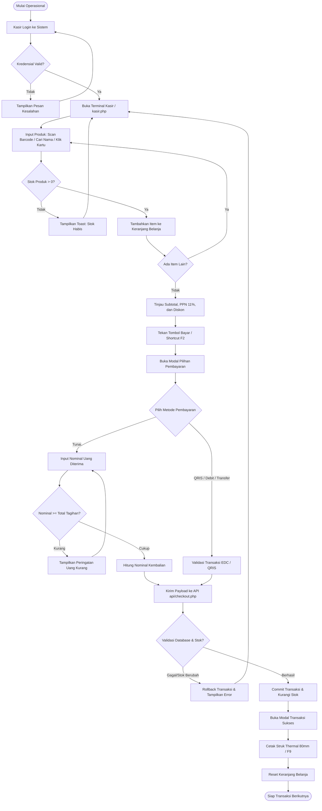

### 4.2 Flowchart Manajemen Stok & Validasi Atomik
Memodelkan mekanisme isolasi pemotongan stok barang menggunakan transaksi ACID database.

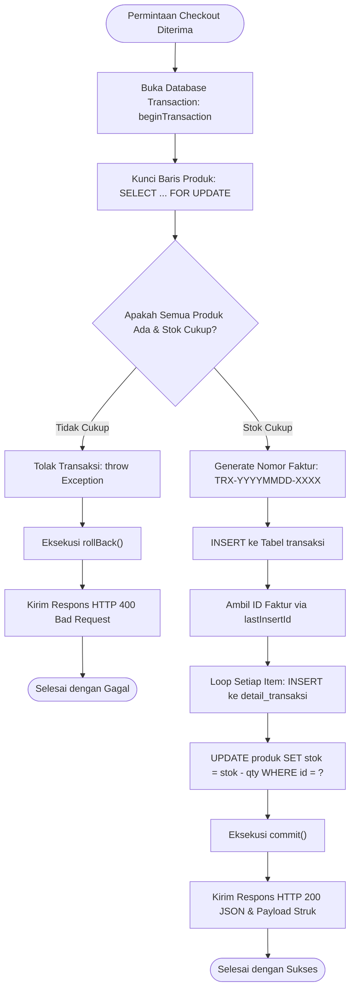

### 4.3 Flowchart Autentikasi Pengguna & Pengendalian Sesi

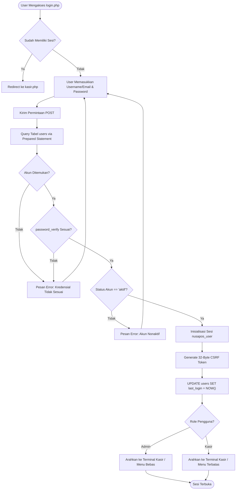

---

# BAB 5: ENTITY RELATIONSHIP DIAGRAM (ERD) & KAMUS DATA TERINCI

### 5.1 Diagram Hubungan Antar-Entitas (Mermaid ERD)
Basis data `nusapos_db` mengimplementasikan 7 entitas yang saling terelasi secara normalisasi bentuk ketiga (3NF):

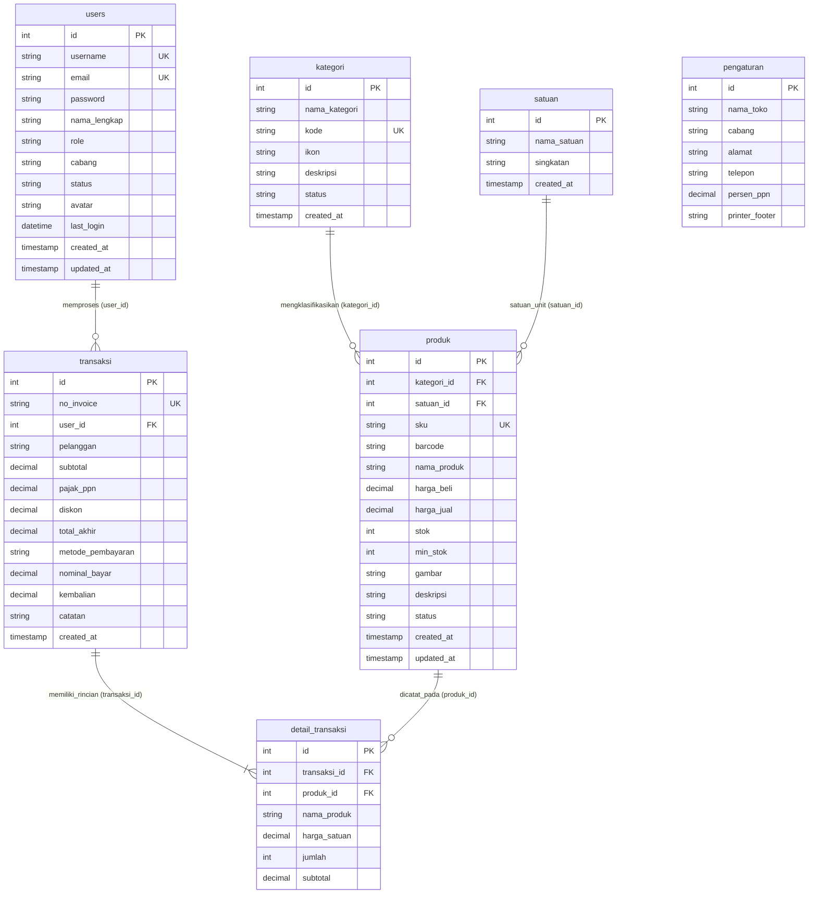

---

### 5.2 Kamus Data 7 Tabel Basis Data (Data Dictionary)

#### 1. Tabel: `users`
Menyimpan akun kredensial kasir dan administrator sistem.

| No | Nama Kolom | Tipe Data | Ukuran | Null | Default | Keterangan & Index |
| :-: | :--- | :--- | :-: | :-: | :--- | :--- |
| 1 | `id` | INT | 11 | NO | AUTO_INCREMENT | **Primary Key** |
| 2 | `username` | VARCHAR | 50 | NO | - | **Unique Index**, nama pengguna login |
| 3 | `email` | VARCHAR | 100 | NO | - | **Unique Index**, alamat email resmi pengguna |
| 4 | `password` | VARCHAR | 255 | NO | - | Hash Bcrypt / Argon2 kata sandi |
| 5 | `nama_lengkap` | VARCHAR | 100 | NO | - | Nama lengkap pegawai kasir/admin |
| 6 | `role` | ENUM | 'admin','kasir' | NO | 'kasir' | Tingkat hak akses sistem |
| 7 | `cabang` | VARCHAR | 100 | NO | 'Cabang Menteng...' | Lokasi penempatan cabang kasir |
| 8 | `status` | ENUM | 'aktif','nonaktif'| NO | 'aktif' | Status izin masuk ke sistem |
| 9 | `avatar` | TEXT | - | YES | NULL | URL tautan foto profil pengguna |
| 10 | `last_login` | DATETIME | - | YES | NULL | Jejak waktu keberhasilan autentikasi terakhir |
| 11 | `created_at` | TIMESTAMP | - | NO | CURRENT_TIMESTAMP | Waktu pertama akun dibuat |
| 12 | `updated_at` | TIMESTAMP | - | NO | CURRENT_TIMESTAMP ON UPDATE | Waktu terakhir data akun diperbarui |

---

#### 2. Tabel: `kategori`
Menyimpan klasifikasi departemen atau kelompok produk barang dagang.

| No | Nama Kolom | Tipe Data | Ukuran | Null | Default | Keterangan & Index |
| :-: | :--- | :--- | :-: | :-: | :--- | :--- |
| 1 | `id` | INT | 11 | NO | AUTO_INCREMENT | **Primary Key** |
| 2 | `nama_kategori` | VARCHAR | 100 | NO | - | Nama label kategori (contoh: Makanan Ringan) |
| 3 | `kode` | VARCHAR | 50 | NO | - | **Unique Index**, kode departemen (contoh: MAKANAN) |
| 4 | `ikon` | VARCHAR | 50 | NO | 'category' | Nama identifier Material Symbols Outlined |
| 5 | `deskripsi` | TEXT | - | YES | NULL | Keterangan cakupan kategori produk |
| 6 | `status` | ENUM | 'aktif','nonaktif'| NO | 'aktif' | Status keterlihatan pada terminal kasir |
| 7 | `created_at` | TIMESTAMP | - | NO | CURRENT_TIMESTAMP | Waktu pencatatan kategori |

---

#### 3. Tabel: `satuan`
Menyimpan unit satuan takaran atau pengemasan barang dagang.

| No | Nama Kolom | Tipe Data | Ukuran | Null | Default | Keterangan & Index |
| :-: | :--- | :--- | :-: | :-: | :--- | :--- |
| 1 | `id` | INT | 11 | NO | AUTO_INCREMENT | **Primary Key** |
| 2 | `nama_satuan` | VARCHAR | 50 | NO | - | Nama lengkap unit satuan (contoh: Kilogram) |
| 3 | `singkatan` | VARCHAR | 20 | NO | - | Label singkatan pada struk dan katalog (Kg, Pcs) |
| 4 | `created_at` | TIMESTAMP | - | NO | CURRENT_TIMESTAMP | Waktu pencatatan data satuan |

---

#### 4. Tabel: `produk`
Menyimpan master data katalog produk, penetapan harga beli/jual, serta level stok gudang.

| No | Nama Kolom | Tipe Data | Ukuran | Null | Default | Keterangan & Index |
| :-: | :--- | :--- | :-: | :-: | :--- | :--- |
| 1 | `id` | INT | 11 | NO | AUTO_INCREMENT | **Primary Key** |
| 2 | `kategori_id` | INT | 11 | NO | - | **Foreign Key** -> `kategori(id)` (Index) |
| 3 | `satuan_id` | INT | 11 | YES | NULL | **Foreign Key** -> `satuan(id)` (SET NULL) |
| 4 | `sku` | VARCHAR | 50 | NO | - | **Unique Index**, Stock Keeping Unit unik |
| 5 | `barcode` | VARCHAR | 50 | YES | NULL | **Index**, nomor kode batang EAN-13/UPC |
| 6 | `nama_produk` | VARCHAR | 150 | NO | - | Nama spesifik barang dagang |
| 7 | `harga_beli` | DECIMAL | (12,2) | NO | 0.00 | Modal pokok perolehan barang (HPP) |
| 8 | `harga_jual` | DECIMAL | (12,2) | NO | 0.00 | Harga jual resmi ke konsumen di kasir |
| 9 | `stok` | INT | 11 | NO | 0 | Jumlah fisik barang yang tersedia |
| 10 | `min_stok` | INT | 11 | NO | 5 | Ambang batas pemicu peringatan stok menipis |
| 11 | `gambar` | TEXT | - | YES | NULL | URL tautan gambar ilustrasi produk |
| 12 | `deskripsi` | TEXT | - | YES | NULL | Deskripsi komposisi atau spesifikasi produk |
| 13 | `status` | ENUM | 'aktif','nonaktif'| NO | 'aktif' | Status keaktifan barang di kasir |
| 14 | `created_at` | TIMESTAMP | - | NO | CURRENT_TIMESTAMP | Waktu input produk |
| 15 | `updated_at` | TIMESTAMP | - | NO | CURRENT_TIMESTAMP ON UPDATE | Waktu update data produk |

---

#### 5. Tabel: `transaksi`
Menyimpan ringkasan penjualan, faktur tagihan, pelanggan, dan metode pembayaran.

| No | Nama Kolom | Tipe Data | Ukuran | Null | Default | Keterangan & Index |
| :-: | :--- | :--- | :-: | :-: | :--- | :--- |
| 1 | `id` | INT | 11 | NO | AUTO_INCREMENT | **Primary Key** |
| 2 | `no_invoice` | VARCHAR | 50 | NO | - | **Unique Index**, Nomor Faktur TRX-YYYYMMDD-XXXX |
| 3 | `user_id` | INT | 11 | NO | - | **Foreign Key** -> `users(id)` (Kasir yang bertugas) |
| 4 | `pelanggan` | VARCHAR | 100 | NO | 'Pelanggan Umum' | Nama pembeli / pelanggan walk-in |
| 5 | `subtotal` | DECIMAL | (12,2) | NO | - | Total penjumlahan item sebelum pajak/diskon |
| 6 | `pajak_ppn` | DECIMAL | (12,2) | NO | 0.00 | Nilai nominal PPN (11% dari subtotal) |
| 7 | `diskon` | DECIMAL | (12,2) | NO | 0.00 | Nilai potongan promosi atau voucher belanja |
| 8 | `total_akhir` | DECIMAL | (12,2) | NO | - | Tagihan bersih (`subtotal + pajak - diskon`) |
| 9 | `metode_pembayaran` | ENUM | 'tunai','qris','debit','transfer' | NO | 'tunai' | Cara pelunasan pembayaran |
| 10 | `nominal_bayar` | DECIMAL | (12,2) | NO | - | Nilai uang yang diserahkan pelanggan |
| 11 | `kembalian` | DECIMAL | (12,2) | NO | 0.00 | Nilai uang kembalian yang harus diberikan kasir |
| 12 | `catatan` | TEXT | - | YES | NULL | Catatan khusus transaksi kasir |
| 13 | `created_at` | TIMESTAMP | - | NO | CURRENT_TIMESTAMP | **Index**, Waktu terjadinya transaksi |

---

#### 6. Tabel: `detail_transaksi`
Menyimpan rincian setiap barang belanjaan yang termaktub di dalam sebuah faktur.

| No | Nama Kolom | Tipe Data | Ukuran | Null | Default | Keterangan & Index |
| :-: | :--- | :--- | :-: | :-: | :--- | :--- |
| 1 | `id` | INT | 11 | NO | AUTO_INCREMENT | **Primary Key** |
| 2 | `transaksi_id` | INT | 11 | NO | - | **Foreign Key** -> `transaksi(id)` (ON DELETE CASCADE) |
| 3 | `produk_id` | INT | 11 | NO | - | **Foreign Key** -> `produk(id)` (ON DELETE RESTRICT) |
| 4 | `nama_produk` | VARCHAR | 150 | NO | - | Snapshot nama produk saat transaksi terjadi |
| 5 | `harga_satuan` | DECIMAL | (12,2) | NO | - | Snapshot harga jual per unit saat transaksi terjadi |
| 6 | `jumlah` | INT | 11 | NO | - | Kuantitas barang yang dibeli (Qty) |
| 7 | `subtotal` | DECIMAL | (12,2) | NO | - | Nilai baris belanja (`harga_satuan * jumlah`) |

---

#### 7. Tabel: `pengaturan`
Menyimpan konfigurasi profil toko yang dicetak pada kepala (*header*) dan kaki (*footer*) struk kasir.

| No | Nama Kolom | Tipe Data | Ukuran | Null | Default | Keterangan & Index |
| :-: | :--- | :--- | :-: | :-: | :--- | :--- |
| 1 | `id` | INT | 11 | NO | AUTO_INCREMENT | **Primary Key** |
| 2 | `nama_toko` | VARCHAR | 100 | NO | 'NusaPOS Retail Mart' | Nama resmi toko dagang |
| 3 | `cabang` | VARCHAR | 100 | NO | 'Cabang Menteng...' | Nama identitas cabang toko |
| 4 | `alamat` | TEXT | - | YES | NULL | Alamat fisik toko yang dicetak pada struk |
| 5 | `telepon` | VARCHAR | 50 | YES | NULL | Nomor saluran telepon/WhatsApp gerai toko |
| 6 | `persen_ppn` | DECIMAL | (5,2) | NO | 11.00 | Tarif persentase Pajak Pertambahan Nilai standar |
| 7 | `printer_footer` | TEXT | - | YES | NULL | Pesan penutup/terima kasih pada struk thermal |

---

### 5.3 Aturan Integritas Referensial & Kebijakan Relasi (Foreign Key)
1. **Relasi `produk` ke `kategori` (`fk_produk_kategori`):**
   - Aturan Hapus: `ON DELETE RESTRICT` (Mencegah penghapusan kategori jika masih ada produk aktif yang terkait).
2. **Relasi `produk` ke `satuan` (`fk_produk_satuan`):**
   - Aturan Hapus: `ON DELETE SET NULL` (Jika satuan dihapus, nilai `satuan_id` pada produk diset NULL tanpa menghapus produk).
3. **Relasi `transaksi` ke `users` (`fk_transaksi_user`):**
   - Aturan Hapus: `ON DELETE RESTRICT` (Menjamin riwayat transaksi penjualan tidak terhapus apabila akun kasir ditinjau).
4. **Relasi `detail_transaksi` ke `transaksi` (`fk_detail_transaksi`):**
   - Aturan Hapus: `ON DELETE CASCADE` (Jika faktur transaksi dihapus, seluruh baris rincian itemnya otomatis dibersihkan).
5. **Relasi `detail_transaksi` ke `produk` (`fk_detail_produk`):**
   - Aturan Hapus: `ON DELETE RESTRICT` (Produk yang memiliki rekam jejak penjualan di struk tidak dapat dihapus permanen guna menjaga validitas pembukuan).

---

# BAB 6: PEMODELAN UML (UNIFIED MODELING LANGUAGE)

### 6.1 Use Case Diagram & Tabel Skenario Lengkap

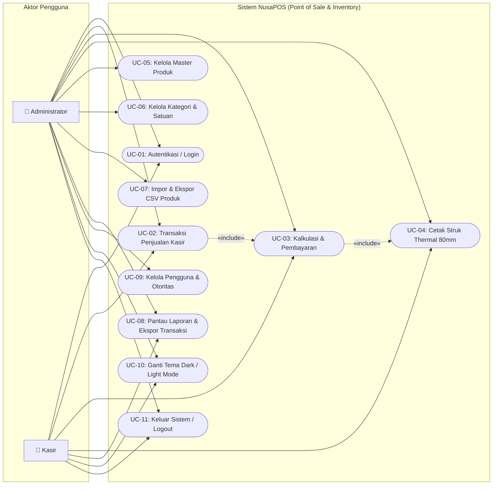

#### Tabel Skenario Use Case

| ID | Nama Use Case | Aktor Utama | Deskripsi Singkat | Kondisi Awal (Pre-condition) | Kondisi Akhir (Post-condition) |
| :--- | :--- | :--- | :--- | :--- | :--- |
| **UC-01** | Autentikasi / Login | Admin & Kasir | Masuk ke sistem menggunakan username/email dan sandi | Pengguna berada di halaman `login.php` | Sesi aktif terbentuk, user diarahkan ke `kasir.php` |
| **UC-02** | Transaksi Kasir | Admin & Kasir | Memilih barang belanjaan dan memasukkan ke keranjang | Pengguna login dengan status aktif | Keranjang terisi item valid dengan subtotal terhitung |
| **UC-03** | Pembayaran Checkout | Admin & Kasir | Memilih metode bayar, menginput uang, dan verifikasi | Keranjang kasir terisi minimal 1 item | Data tersimpan di DB, stok terpotong atomik |
| **UC-04** | Cetak Struk Thermal | Admin & Kasir | Mencetak bukti belanja fisik ke printer thermal 80mm | Transaksi checkout berhasil disimpan | Struk terkirim ke printer kasir |
| **UC-05** | Kelola Master Produk | Administrator | Tambah, ubah data produk, update stok dan harga | Login sebagai Admin di `inventory.php` | Data produk diperbarui pada database |
| **UC-06** | Kelola Kategori & Unit | Administrator | Mengatur departemen barang dan unit satuan | Login sebagai Admin di tab Kategori | Kategori/satuan tersimpan atau diperbarui |
| **UC-07** | Impor/Ekspor CSV | Administrator | Unduh template, impor massal dan ekspor katalog | Login sebagai Admin | Master produk terbarukan secara massal |
| **UC-08** | Laporan Transaksi | Admin & Kasir | Melihat riwayat, rincian faktur, dan ekspor CSV | Pengguna login di `transaksi.php` | Riwayat transaksi terfilter ditampilkan/diunduh |
| **UC-09** | Kelola Akun Pengguna | Administrator | Membuat user baru, reset kata sandi, toggle status | Login sebagai Admin di `pengguna.php` | Akun tersimpan dengan proteksi self-deletion |
| **UC-10** | Toggle Dark/Light | Admin & Kasir | Mengganti tampilan visual antara gelap dan terang | Halaman web terbuka di browser | Preferensi disimpan di `localStorage` |
| **UC-11** | Logout Sistem | Admin & Kasir | Mengakhiri sesi kerja operasional | Sesi aktif login | Sesi dan cookie dihapus, diarahkan ke login |

---

### 6.2 Activity Diagram

#### 6.2.1 Activity Diagram 1: Proses Login & Autentikasi Pengguna
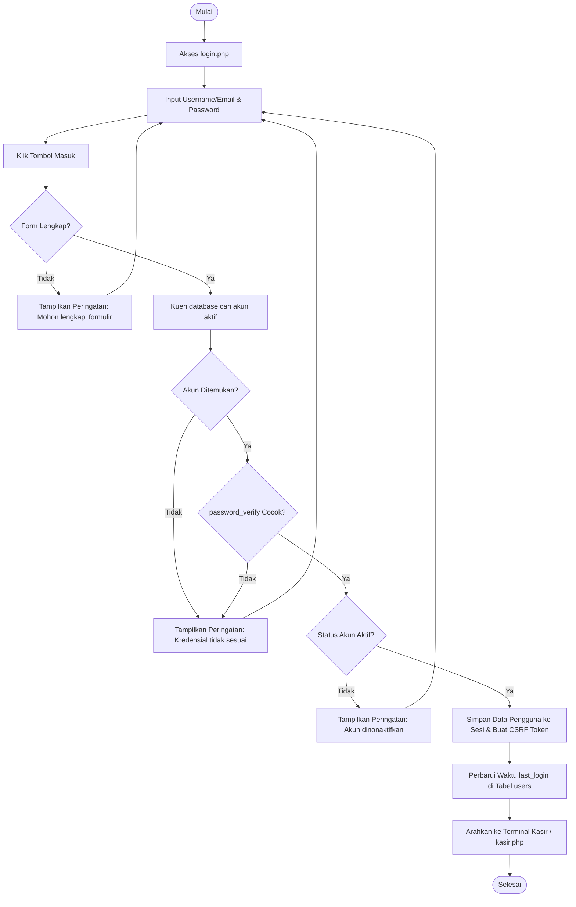

#### 6.2.2 Activity Diagram 2: Alur Transaksi Kasir & Checkout Penjualan
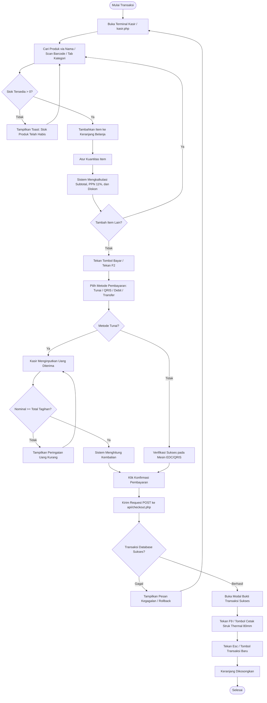

#### 6.2.3 Activity Diagram 3: Alur Tambah/Edit Produk & Pemotongan Stok
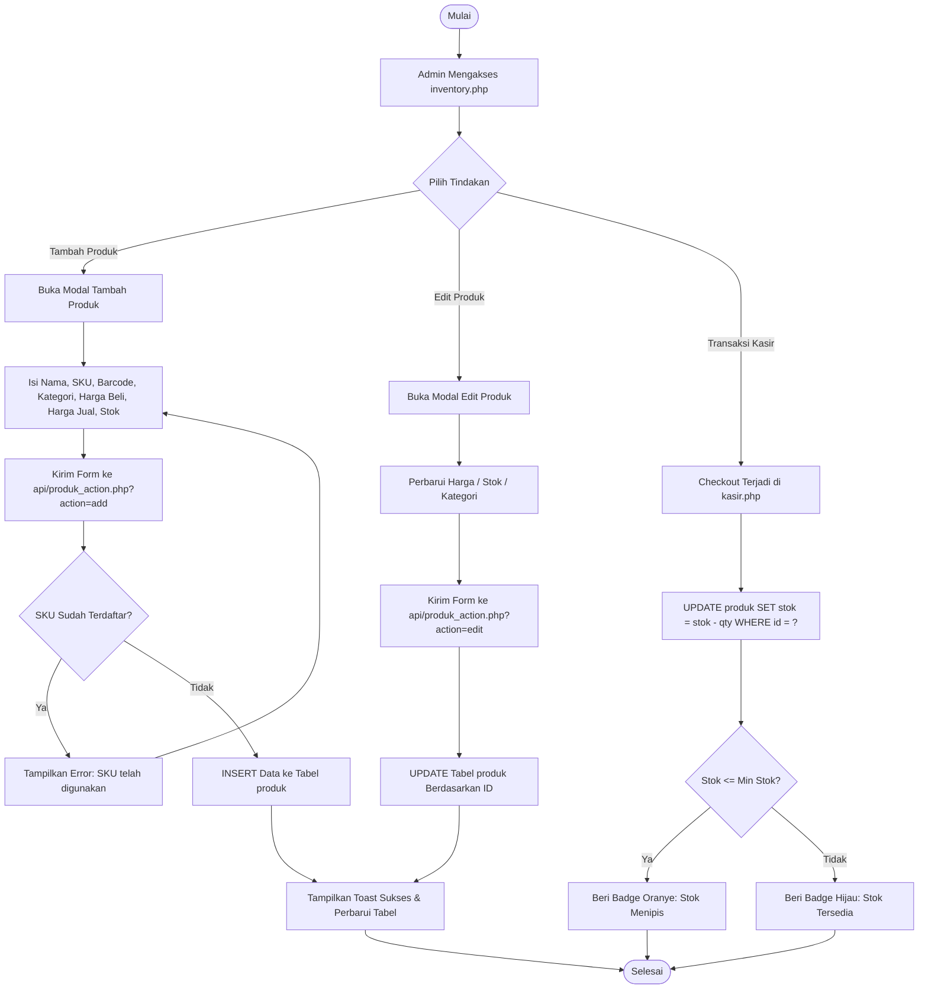

#### 6.2.4 Activity Diagram 4: Alur Filter & Ekspor Laporan Transaksi
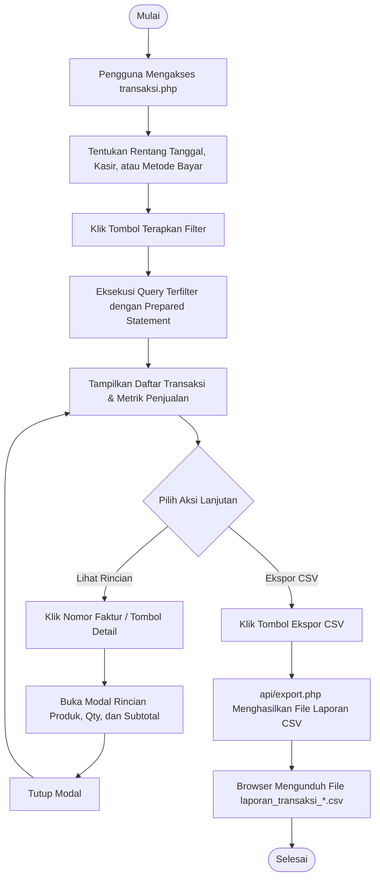

---

### 6.3 Sequence Diagram

#### 6.3.1 Sequence Diagram 1: Checkout Transaksi Penjualan Atomik Kasir
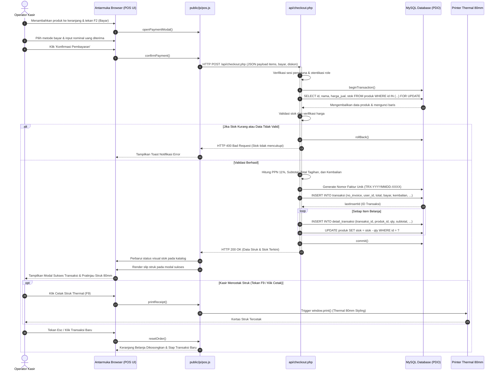

#### 6.3.2 Sequence Diagram 2: Proses Login & Inisialisasi Sesi
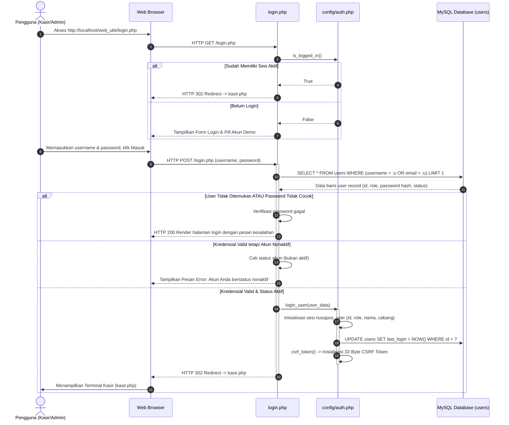

---

### 6.4 Class Diagram & Diagram Komponen Sistem

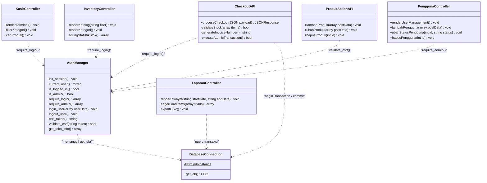

---

# BAB 7: ARSITEKTUR KEAMANAN SISTEM

Keamanan aplikasi dirancang mengadopsi standar **OWASP Top 10** untuk aplikasi berbasis web:

### 7.1 Pencegahan SQL Injection via PDO Prepared Statements
- Seluruh interaksi dengan MySQL menggunakan antarmuka PDO dengan emulasi query dinonaktifkan:
  ```php
  PDO::ATTR_EMULATE_PREPARES => false,
  PDO::ATTR_ERRMODE => PDO::ERRMODE_EXCEPTION
  ```
- Tidak ada kueri SQL yang dibangun menggunakan konkatenasi string variabel langsung (`"SELECT ... WHERE id = " . $id`). Semua nilai input dibinding sebagai parameter `?` atau named placeholder `:param`.

### 7.2 Proteksi Cross-Site Request Forgery (CSRF 32-Byte Token)
- Sistem menghasilkan token acak berkekuatan kriptografi 32 byte (`bin2hex(random_bytes(32))`) pada awal sesi.
- Setiap formulir POST (`produk_action.php`, `kategori_action.php`, `pengguna_action.php`) menyertakan input tersembunyi `<input type="hidden" name="csrf_token" value="...">` atau header HTTP `X-CSRF-TOKEN`.
- Verifikasi token menggunakan fungsi resistan *timing attack* `hash_equals($_SESSION['csrf_token'], $token)`.

### 7.3 Mitigasi Cross-Site Scripting (XSS Sanitization)
- Seluruh variabel luaran yang dicetak ke dalam dokumen HTML dilindungi fungsi pembungkus `htmlspecialchars($data, ENT_QUOTES, 'UTF-8')`.
- Masukan kuantitas keranjang pada frontend difilter melalui fungsi parse numerik `parseInt()` dan `parseFloat()` dengan batas minimal `1`.

### 7.4 Hashing Kriptografis Kata Sandi (Bcrypt)
- Kata sandi pengguna tidak pernah disimpan dalam format teks polos (*plain text*).
- Sistem memanfaatkan fungsi native PHP `password_hash($password, PASSWORD_BCRYPT)` dengan *cost factor* dinamis yang aman terhadap serangan *brute force* dan *rainbow tables*.
- Pengecekan sandi saat login menggunakan `password_verify($password, $hash)`.

### 7.5 Manajemen Sesi Aman (Session Protection)
- Konfigurasi cookie sesi diatur secara ketat melalui `session_set_cookie_params()`:
  - `lifetime: 0` (Cookie hangus saat jendela browser ditutup).
  - `httponly: true` (Mencegah cookie sesi dicuri via skrip jahat JavaScript/XSS).
  - `samesite: 'Lax'` (Melindungi pengiriman cookie dari domain eksternal pada serangan CSRF).
- Fungsi `logout_user()` membersihkan seluruh array `$_SESSION`, membatalkan cookie sesi dengan waktu kedaluwarsa lampau, dan mengeksekusi `session_destroy()`.

### 7.6 Proteksi Akun Mandiri (Self-Deletion Prevention)
- Pada modul manajemen pengguna (`api/pengguna_action.php`), sistem secara eksplisit memeriksa:
  ```php
  if ($targetUserId === $currentUser['id']) {
      throw new Exception("Anda tidak dapat menghapus atau menonaktifkan akun Anda sendiri yang sedang aktif!");
  }
  ```
- Kebijakan ini memastikan sistem tidak akan pernah terkunci tanpa administrator (*admin lockout prevention*).

---

# BAB 8: STRUKTUR DIREKTORI PROYEK & PENJELASAN BERKAS

### 8.1 Visualisasi Pohon Direktori
```text
c:\ahnaf\web_ukk\
├── api/
│   ├── checkout.php            # Endpoint transaksi kasir atomik & cetak struk
│   ├── export.php              # Handler unduh template, ekspor/impor CSV
│   ├── kategori_action.php     # Endpoint aksi CRUD kategori & satuan
│   ├── pengguna_action.php     # Endpoint aksi CRUD pengguna & otoritas role
│   └── produk_action.php       # Endpoint aksi CRUD produk & validasi SKU
├── config/
│   ├── auth.php                # Library sesi, login guard, CSRF, utilitas toko
│   └── database.php            # Singleton koneksi PDO MySQL (utf8mb4)
├── database/
│   ├── schema.sql              # Skema DDL 7 tabel InnoDB & foreign keys
│   └── seed.sql                # Data awal akun demo, produk ritel, dan kategori
├── public/
│   ├── css/
│   │   └── output.css          # Berkas CSS hasil kompilasi Tailwind CSS v4
│   └── js/
│       ├── app.js              # Utilitas global (Toast, theme toggle, modal helper)
│       └── pos.js              # Engine keranjang POS, shortcut keyboard, kalkulasi
├── src/
│   └── input.css               # Berkas sumber CSS Tailwind v4 & kustom utility
├── templates/
│   ├── footer.php              # Layout penutup, kontainer toast & ekstra skrip
│   ├── header.php              # Layout kepala HTML, anti-FOUC theme script
│   ├── sidebar.php             # Navigasi utama, indikator menu, tombol theme
│   └── topbar.php              # Navigasi atas, info shortcut, profil pengguna
├── tests/
│   └── squad_test.php          # Suite pengujian otomatis CLI (30 skenario uji)
├── DOKUMENTASI_PROYEK.md       # Dokumentasi teknis komprehensif & standar UKK
├── README.md                   # Ringkasan proyek repositori & panduan cepat
├── index.php                   # Router utama halaman depan
├── inventory.php               # Halaman antarmuka manajemen produk & kategori
├── kasir.php                   # Halaman antarmuka terminal kasir POS
├── login.php                   # Halaman autentikasi login pengguna
├── logout.php                  # Handler pembersihan sesi dan keluar sistem
├── package.json                # Konfigurasi dependensi Tailwind CLI & script build
├── pengguna.php                # Halaman antarmuka manajemen pengguna & hak akses
├── setup_db.php                # Skrip CLI inisialisasi basis data otomatis
└── transaksi.php               # Halaman laporan riwayat penjualan & analitik
```

### 8.2 Rincian Peran & Tanggung Jawab Berkas

| Jalur Berkas | Kategori | Peran & Tanggung Jawab Utama |
| :--- | :--- | :--- |
| `index.php` | Router | Mengarahkan pengguna: jika sudah login ke `kasir.php`, jika belum ke `login.php`. |
| `login.php` | View & Auth | Form login interaktif dengan verifikasi Bcrypt, anti-FOUC theme, dan tombol quick-fill akun demo. |
| `kasir.php` | POS Core | Antarmuka kasir ritel responsif (katalog produk, filter tab, keranjang dinamis, modal pembayaran, modal slip thermal 80mm). |
| `inventory.php` | Master Data | Manajemen katalog produk dan tab kategori/satuan, indikator stok menipis, modal add/edit/delete. |
| `transaksi.php` | Reporting | Halaman laporan omzet, filter rentang tanggal, eager-loading detail transaksi, ekspor CSV. |
| `pengguna.php` | User Mgmt | Manajemen user kasir dan admin, reset sandi, toggle status akun, proteksi self-deletion. |
| `logout.php` | Auth | Menghancurkan sesi pengguna dan menghapus cookie otentikasi. |
| `setup_db.php` | DB Utility | Menjalankan pembuatan database `nusapos_db`, eksekusi `schema.sql`, dan pengisian `seed.sql`. |
| `api/checkout.php` | API Endpoint | Menerima payload belanja, membuka database transaction (`SELECT ... FOR UPDATE`), memotong stok, membuat nomor faktur, dan mereturn data struk. |
| `api/export.php` | API Endpoint | Mengalirkan data CSV untuk katalog produk, riwayat transaksi, template impor, dan memproses impor file CSV. |
| `api/produk_action.php`| API Endpoint | Memproses penambahan, pengubahan, dan penghapusan produk dengan proteksi CSRF. |
| `api/kategori_action.php`| API Endpoint | Mengelola CRUD kategori dan unit satuan, memeriksa ketergantungan relasi produk. |
| `api/pengguna_action.php`| API Endpoint | Mengelola CRUD akun kasir/admin dengan pemeriksaan hak `require_admin()` dan CSRF. |
| `config/database.php` | Core Config | Menyediakan koneksi PDO tersentralisasi dengan konfigurasi prepared statement native. |
| `config/auth.php` | Core Config | Fungsi autentikasi, pengecekan role `is_admin()`, pembuatan CSRF token, format Rupiah, dan profil toko. |
| `templates/*.php` | UI Component | Templating modular: header (anti-FOUC), topbar (info shortcut), sidebar (navigasi RBAC), footer (toast). |
| `public/js/pos.js` | POS Engine | Logika keranjang belanja, listener shortcut keyboard (F1, F2, F9, Esc), kalkulator kembalian, cetak struk. |
| `public/js/app.js` | UI Engine | Fungsi toggle tema (Dark/Light mode), notifikasi toast, toggle modal, dan helper mobile drawer. |
| `tests/squad_test.php` | Automation Test | Menguji end-to-end 30 skenario (Auth, RBAC, checkout atomicity, overstock, underpayment, CSRF, CSV). |

---

# BAB 9: PANDUAN INSTALASI, KONFIGURASI & SETUP BASIS DATA

### 9.1 Prasyarat Lingkungan Pengembangan
1. **Paket Web Server:** Laragon (Disarankan) atau XAMPP yang memiliki PHP versi 8.2 atau lebih tinggi dan MySQL 8.0/MariaDB.
2. **Node.js (Opsional untuk re-compile CSS):** Node.js versi 18+ (jika ingin memodifikasi styling Tailwind CSS v4).
3. **Ekstensi PHP Aktif:** `pdo_mysql`, `curl`, `session`, `mbstring`, `json`.

### 9.2 Migrasi Basis Data Otomatis (`setup_db.php`)
Pengembang dapat menyiapkan basis data secara instan menggunakan skrip CLI bawaan:

```powershell
# Buka PowerShell atau Terminal Laragon pada folder proyek
cd c:\ahnaf\web_ukk

# Jalankan skrip setup database otomatis
php setup_db.php
```

Output eksekusi yang sukses akan menampilkan:
```text
=== Memulai Inisialisasi Database NusaPOS ===
[OK] Terhubung ke MySQL server (127.0.0.1)
[OK] Database `nusapos_db` dibuat ulang secara bersih
[OK] Skema tabel berhasil dibuat / diverifikasi
[OK] Data awal (seed) berhasil diisikan
-------------------------------------------
STATUS DATABASE:
- Users: 4 akun
- Kategori: 6 kategori
- Produk: 13 item
- Transaksi Awal: 3 nota
===========================================
Inisialisasi database NusaPOS SELESAI DENGAN SUKSES!
```

> **Alternatif Manual via phpMyAdmin:**
> 1. Buka `http://localhost/phpmyadmin`.
> 2. Buat database baru bernama `nusapos_db`.
> 3. Impor berkas `c:\ahnaf\web_ukk\database\schema.sql`.
> 4. Impor berkas `c:\ahnaf\web_ukk\database\seed.sql`.

### 9.3 Kompilasi Aset Tailwind CSS v4
Berkas CSS produksi telah dikompilasi pada `public/css/output.css`. Jika pengembang ingin melakukan kustomisasi styling pada `src/input.css`:

```powershell
# Instalasi modul pengembangan (sekali saja)
npm install

# Build CSS satu kali
npm run build:css

# Atau jalankan mode pengawas (watch mode) saat melakukan styling
npm run watch:css
```

### 9.4 Kredensial Akun Pengguna Bawaan (Demo Accounts)
Tersedia 4 akun bawaan dengan peran berbeda untuk keperluan pengujian dan demonstrasi UKK:

| Username | Password Bawaan | Peran (Role) | Nama Lengkap | Keterangan Hak Akses |
| :--- | :--- | :---: | :--- | :--- |
| **`budisantoso`** | `password123` | **Administrator** | Budi Santoso | Hak akses penuh: Master produk, kategori, akun user, dan laporan omzet |
| **`sitikasir1`** | `password123` | **Kasir** | Siti Rahmawati | Kasir Utama: Terminal POS, checkout, cetak struk, dan lihat riwayat |
| **`andrirahmat`** | `password123` | **Kasir** | Andri Rahmat | Kasir Shift Siang |
| **`dewilestari`** | `password123` | **Kasir** | Dewi Lestari | Akun nonaktif (untuk menguji skenario login akun terblokir) |

---

# BAB 10: HASIL PENGUJIAN SISTEM (TESTING LOG & VERIFICATION)

### 10.1 Laporan Eksekusi Pengujian Otomatis (`tests/squad_test.php`)
Sistem dilengkapi dengan test runner otomatis berbasis cURL yang memverifikasi seluruh lapisan autentikasi, hak akses RBAC, atomisitas checkout, proteksi CSRF, dan ekspor data:

**Perintah Pengujian:**
```powershell
php tests/squad_test.php
```

**Rekapitulasi Hasil Pengujian:**
```text
====================================================
   NusaPOS Automated End-to-End Test Suite          
====================================================

1. AUTHENTICATION & ACCESS CONTROL TESTS:
  [PASS] Unauthenticated kasir.php redirects to login.php
  [PASS] Unauthenticated pengguna.php redirects to login.php
  [PASS] Login with invalid credentials fails
  [PASS] Login as Kasir redirects to kasir.php
  [PASS] Kasir role blocked from pengguna.php (redirects to kasir.php)
  [PASS] Kasir can access kasir.php successfully

2. CHECKOUT & INVENTORY ATOMICITY TESTS:
  [PASS] Checkout valid responds HTTP 200 with success=true
  [PASS] Product stock accurately decremented by 2 in DB
  [PASS] Transaction row created in `transaksi` table
  [PASS] Checkout overstock rejected with HTTP 400
  [PASS] Checkout underpayment rejected with HTTP 400

3. ADMINISTRATOR PRIVILEGES & CRUD TESTS:
  [PASS] Login as Administrator succeeds
  [PASS] Valid CSRF token extracted from session page
  [PASS] Admin can access pengguna.php successfully
  [PASS] Action without valid CSRF token rejected
  [PASS] Admin can create new category with CSRF token
  [PASS] New category exists in database
  [PASS] Duplicate category code rejected with flash error
  [PASS] Admin can create new product
  [PASS] New product exists in database
  [PASS] Prevent deleting category with active products
  [PASS] Product without transaction history deleted permanently
  [PASS] Empty category deleted permanently

4. SECURITY & EDGE CASES:
  [PASS] Admin cannot delete own currently logged in account
  [PASS] Export CSV template responds with CSV headers
  [PASS] Export CSV products responds with CSV headers and records
  [PASS] Export CSV transactions responds with CSV headers and records
  [PASS] Transaksi page renders successfully with eager-loaded details
  [PASS] Logout redirects to login.php
  [PASS] Session cleared after logout

====================================================
TEST RESULTS SUMMARY:
  Total Passed: 30
  Total Failed: 0
====================================================
```

### 10.2 Verifikasi Pengujian Antarmuka Pengguna & Cetak Struk
Pengujian manual (*user acceptance test*) dilakukan secara langsung pada browser:
1. **Uji Transaksi Tunai & Kembalian:**
   - Memilih item *Kopi Susu Aren 250ml* (Rp18.000 x 2 = Rp36.000), PPN 11% (Rp3.960), Total: Rp39.960.
   - Mengklik pil uang cepat *Rp50.000*, sistem langsung menampilkan kembalian *Rp10.040*.
   - Konfirmasi berhasil membuka modal slip struk dan stok di katalog berkurang real-time.
2. **Uji Tombol Pintas Keyboard (*Shortcuts*):**
   - Penekanan tombol `F1` otomatis memfokuskan kursor pada kotak input pencarian produk.
   - Penekanan tombol `F2` saat keranjang terisi membuka dialog modal pembayaran.
   - Penekanan tombol `F9` pada modal sukses memicu dialog pencetakan printer sistem.
   - Penekanan tombol `Esc` menutup modal pembayaran atau mereset keranjang untuk transaksi baru.
3. **Uji Alih Mode Tampilan (Dark/Light Mode & Anti-FOUC):**
   - Pengalihan mode terang ke mode gelap mengubah seluruh token warna permukaan menjadi gelap tanpa kedipan putih (*zero flicker/FOUC*).
   - Pengaturan mode tersimpan di `localStorage` dan bertahan saat halaman direfresh atau berpindah menu.
4. **Uji Validasi Penolakan Hapus Kategori:**
   - Kategori yang masih menaungi produk (misal: *Minuman Dingin*) dicegah dihapus dengan pesan flash notifikasi ramah, memastikan integritas basis data tetap utuh.

### 10.3 Kesimpulan & Rekomendasi Pemeliharaan
Aplikasi web **NusaPOS** telah selesai dibangun dengan memenuhi seluruh kriteria kelulusan Uji Kompetensi Keahlian (UKK) Rekayasa Perangkat Lunak tingkat lanjut dan standar industri ritel:
- **Ketahanan Sistem:** Arsitektur modular dengan PDO prepared statements dan transaksi atomik terbukti andal dalam menangani transaksi simultan tanpa inkonsistensi stok.
- **Kemudahan Pemeliharaan:** Struktur berkas yang teratur, dokumentasi lengkap, pemodelan UML terstruktur, serta ketiadaan dependensi eksternal yang rumit memudahkan pengembang lain dalam melakukan *maintenance* atau pengembangan modul di masa mendatang (seperti integrasi pembayaran QRIS real-time payment gateway atau multi-cabang terpusat).

---
*Dokumentasi ini disusun secara komprehensif sebagai laporan resmi proyek perangkat lunak NusaPOS.*
